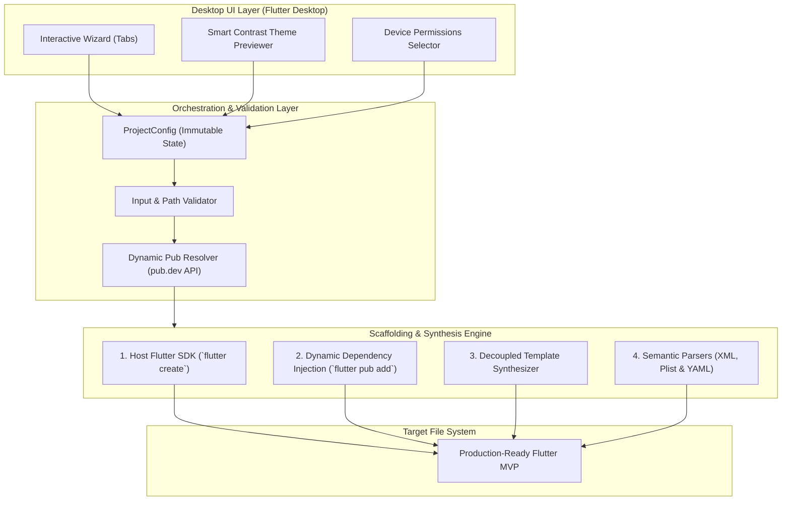

# 🏛️ FLRD Architecture & Engineering Design

This document details the architectural decisions, design patterns, and engineering principles behind **FLRD (Flutter Rapid Deployment)**.

---

## 🎯 Core Engineering Mission

Scaffolding tools frequently suffer from **rapid obsolescence**: frameworks evolve, package versions deprecate, and native build chains (Gradle, Kotlin, Xcode, Swift Package Manager) break brittle templates.

FLRD is architected under one strict rule:
> **Resilience over Hardcoding:** Never recreate what the host SDK does best, never freeze dynamic dependencies, and never manipulate code via brittle regex.

---

## 🧩 System Architecture

FLRD separates the user experience from code generation through a clear multi-layered architecture:



---

## 🛡️ The 5 Pillars of Anti-Obsolescence

### 1. Host SDK Grounding (No Synthetic Project Baselines)
FLRD **never** generates the root Android, iOS, Web, or Desktop project folders from pre-saved boilerplate.
* It directly invokes the user's local `flutter create --org <org> --project-name <name> <dir>`.
* **Benefit:** When Flutter updates Gradle to Kotlin DSL (`.kts`), bumps the Android Gradle Plugin (AGP), or migrates to Swift Package Manager, the base project is automatically 100% compliant with the user's active Flutter SDK.

### 2. Dynamic Dependency Resolution (Zero Frozen Versions)
* We avoid freezing version strings like `flutter_riverpod: ^2.4.9` in templates.
* Instead, FLRD calls `flutter pub add <packages>` during project synthesis, allowing the Dart pub solver to pick the highest compatible stable release for the user's specific environment.
* For visual feedback in the UI, FLRD queries the official `pub.dev` API (`https://pub.dev/api/packages/<pkg>`) to display current live releases.

### 3. Decoupled & Remote-Synchronized Templates
* Templates are not hardcoded as static multiline strings inside the compiled desktop binary.
* Templates are isolated as modular files (using Mustache/liquid syntax) indexed via a `manifest.json`.
* The desktop application can pull the latest template iterations directly from the official repository or use local cache when offline. Updating a template does not require recompiling or reinstalling the desktop app.

### 4. Semantic Manipulation (AST & Parsers over Regex)
Modifying native files like `AndroidManifest.xml`, `Info.plist`, and `pubspec.yaml` via regular expressions or string replacement is the #1 cause of corruption in code generators.
* **Android Manifest:** Handled via the Dart `xml` package. Permissions are inserted as structured XML elements with proper attributes and namespaces.
* **iOS Info.plist:** Handled via structured Property List parsers. Usage descriptions (e.g. `NSCameraUsageDescription`) are guaranteed syntactically valid.
* **Pubspec Configuration:** Handled via `yaml_edit` to ensure indentation, structure, and developer comments remain intact.

### 5. Automated "Canary" Verification (CI/CD Pipeline)
To ensure that changes in upstream Flutter channels never silently break FLRD:
* A weekly GitHub Actions workflow executes an automated build test.
* The test runs FLRD against Flutter `stable` and `beta` channels, generating every supported preset (*SaaS, Clean-Lite, Offline*).
* It runs `flutter analyze` and `flutter test` against each generated app.
* If any deprecation warning or compilation error occurs, the CI automatically files a high-priority GitHub Issue.

---

## 📂 Proposed Repository Structure

```
flrd/
├── .github/
│   └── workflows/
│       ├── test_desktop.yml        # Tests the FLRD desktop app
│       └── canary_templates.yml    # Weekly test of generated presets
│
├── assets/
│   ├── templates/                  # Bundled offline fallback templates
│   │   ├── presets/
│   │   │   ├── saas/
│   │   │   ├── clean_lite/
│   │   │   └── offline/
│   │   └── manifest.json
│   └── icons/
│
├── lib/
│   ├── core/
│   │   ├── theme/                  # Smart Contrast Theme Engine (WCAG compliance)
│   │   ├── network/                # Pub.dev API client
│   │   └── utils/                  # Shell execution and file helpers
│   │
│   ├── features/
│   │   ├── wizard/                 # Desktop UI step-by-step navigation
│   │   │   ├── models/             # ProjectConfig, Preset, PermissionEnums
│   │   │   └── presentation/       # Tabs: Details, Navigation, Theme, Permissions
│   │   │
│   │   └── generator/              # Synthesis engine
│   │       ├── pipeline/           # Step executor (create -> pub -> templates -> native)
│   │       ├── injectors/          # Android XML & iOS Plist semantic mutators
│   │       └── template_engine/    # Token replacement & code synthesis
│   │
│   └── main.dart                   # Desktop window bootstrap
│
├── test/
├── pubspec.yaml
├── ARCHITECTURE.md
├── CONTRIBUTING.md
├── LICENSE
└── README.md
```

---

## 🎨 Smart Contrast Theme Algorithm

The theme engine follows WCAG 2.1 contrast formulas:
$$\text{Relative Luminance } L = 0.2126 R + 0.7152 G + 0.0722 B$$
$$\text{Contrast Ratio} = \frac{L_1 + 0.05}{L_2 + 0.05}$$

Whenever a primary seed color is chosen, FLRD calculates:
1. An optimal accessible typography color (`onSurface`, `onPrimary`, `onSecondary`).
2. Automatic fallback lightness adjustment if the user's selected primary fails the minimum 4.5:1 ratio on dark surfaces.
3. Persistent storage integration using modern key-value storage.
