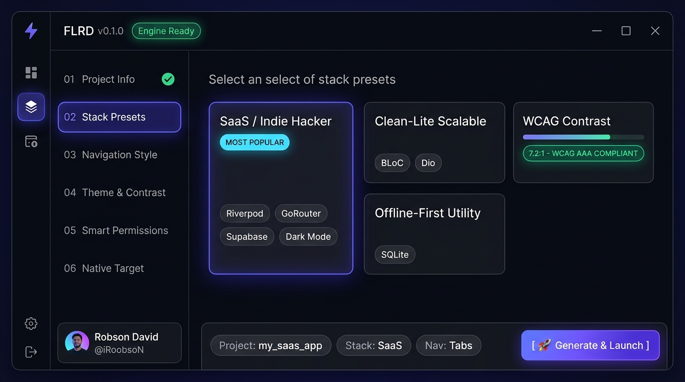
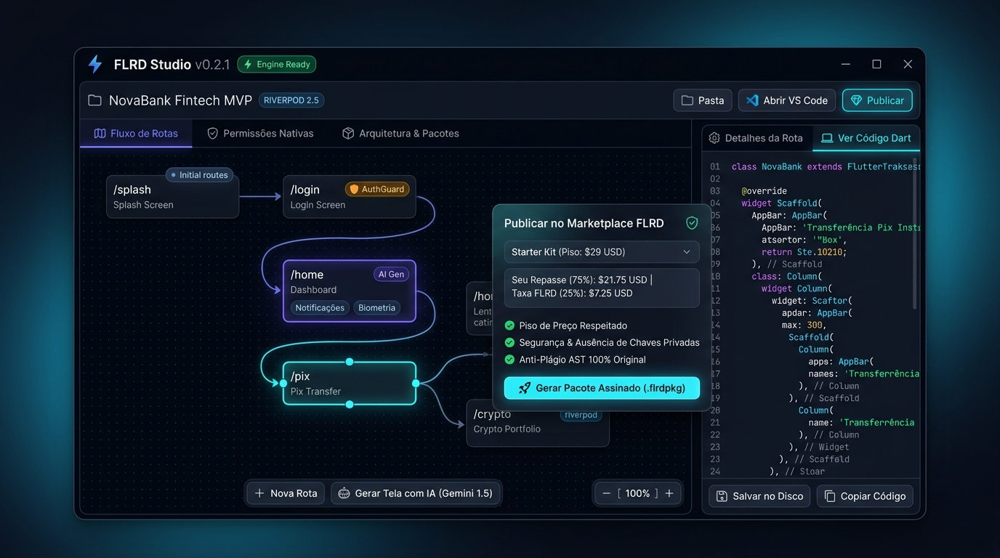
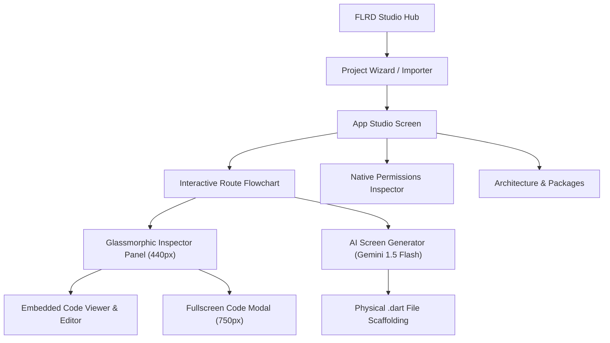
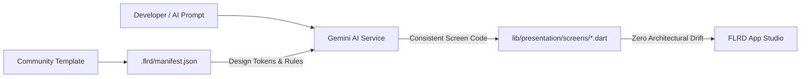

<div align="center">

# ⚡ FLRD (Flutter Rapid Deployment)

**The sleek desktop launcher & visual studio to scaffold and engineer production-ready Flutter apps in seconds.**

[](https://flutter.dev)
[](https://dart.dev)
[](https://github.com/iRoobsoN/flrd/actions/workflows/ci.yml)
[](https://github.com/iRoobsoN/flrd/releases/tag/v0.2.1)
[-28a745?style=for-the-badge&logo=windows&logoColor=white)](https://github.com/iRoobsoN/flrd/releases/latest)
[](LICENSE)
[](CONTRIBUTING.md)
[](https://www.paypal.com/cgi-bin/webscr?cmd=_donations&business=robson.dv14@gmail.com&currency_code=USD)
[](#-support-the-project--apoie-o-projeto)

<p align="center">
  <em>"A Flutter visual studio designed to scaffold and evolve Flutter apps."</em>
  <br />
  Conceived by <strong>Robson David</strong> (<strong>FL</strong>utter <strong>R</strong>obson <strong>D</strong>avid / <strong>F</strong>lutter <strong>R</strong>apid <strong>D</strong>eployment)
</p>

<p align="center">
  
</p>

[Features](#-key-features) • [App Studio](#-visual-app-studio--route-flowchart) • [Embedded Editor](#-embedded-code-viewer--editor) • [AI Studio](#-real-ai-screen-studio-gemini-15-flash) • [Marketplace](#-community-templates-marketplace) • [Reverse Engineering](#-reverse-engineering--project-ingestion) • [Download](#-download--getting-started) • [Donate](#-support-the-project--apoie-o-projeto)

</div>

---

## 💡 The Problem

Every time you have an idea for a new mobile app, SaaS, or hackathon MVP, running `flutter create` gives you... a single `main.dart` with a counter app.

To turn that into a real application, you spend the next **2 to 3 hours** doing repetitive, non-creative plumbing:
- ⏳ Configuring router and route guards (`go_router`)
- ⏳ Setting up auth state and session listeners (Supabase / Firebase)
- ⏳ Wiring state management boilerplate (Riverpod / Bloc / SQLite)
- ⏳ Configuring dark/light mode persistence and WCAG contrast
- ⏳ Creating folder structures, `.env` handlers, and responsive layouts
- ⏳ Manually synchronizing native Android and iOS permissions

**FLRD kills the boilerplate tax.** You configure your project visually in a stunning desktop UI, explore the architecture in an interactive route flowchart, generate new screens using Gemini 1.5 Flash AI, edit code directly inside the embedded editor, hit **Generate**, and your IDE opens with a fully functional, production-structured app ready for feature code.

---

## ✨ Key Features

- 🌐 **FLRD Studio Hub & Multi-language (i18n)**:
  - Central launchpad with quick actions: *Novo Projeto*, *Importar Projeto*, and *Explorar Marketplace*.
  - Instant reactive language switching across **Português (🇧🇷)**, **English (🇺🇸)**, and **Español (🇪🇸)** without application restart.
- 🗺️ **Visual App Studio & Interactive Route Flowchart**:
  - Infinite pan/zoom canvas powered by `InteractiveViewer` with center/reset controls.
  - Custom Bézier curved connectors with directional arrows and blueprint dot grid.
  - Interactive route cards with route paths, `AuthGuard` status pills, `AI Gen` badges, and permission chips.
- 💻 **Embedded Code Viewer & Editor**:
  - Glassmorphic side inspector panel (440px) with segmented switcher: `[⚙️ Detalhes da Rota]` and `[💻 Ver Código Dart]`.
  - Monospace gutter line numbers with real-time Dart token syntax highlighting matching Obsidian Glass dark theme.
  - Direct atomic file writing to disk (`File.writeAsString`) and one-click clipboard copying.
  - Fullscreen 750px modal code dialog (`_showFullscreenCodeModal`) for wide-screen code inspection.
- 🧠 **Real AI Screen Studio (Google Gemini 1.5 Flash)**:
  - Direct Google Gemini 1.5 Flash REST API integration with Bring-Your-Own-Key (BYOK) privacy.
  - Strict architectural prompt conditioning enforcing design tokens, state management, and error handling.
  - Generates physical `.dart` files on disk with folder scaffolding and injects them into the flowchart.
  - Resilient offline fallback generator for guaranteed continuity without network access.
- 🛍️ **Community Templates Marketplace & Consistency Manifest**:
  - Curated initial kits: NovaBank (FinTech), SaaSHero (Subscription SaaS), FoodDelivery Pro (Logistics), OfflineVault (Encrypted Local Storage), and FitPulse (Health Tracking).
  - Anti-drift Consistency Manifest (`.flrd/manifest.json`): locks design tokens, state management rules, and AI prompts against code fragmentation.
  - Automated 75% creator / 25% platform revenue split model.
- 📂 **Reverse Engineering & Project Ingestion**:
  - Deep static analysis of existing Flutter codebases: detects state management (Riverpod, BLoC, SQLite, Provider), scans `AndroidManifest.xml` and `Info.plist`, discovers screen files, and generates a visual route topology with manifest file.
- ⚙️ **Frictionless Native Config (Android & iOS)**:
  - Smart `build.gradle` / `.gradle.kts` setup: automated `minSdkVersion`, `targetSdkVersion`, `multidex`, and namespace configuration without editing fragile native files.
  - Painless iOS `Info.plist` & `Podfile` configuration with safe deployment targets.
- 🎨 **Smart Contrast Theme Engine**:
  - Live preview of Light & Dark modes with automated WCAG AAA contrast calculation.
  - Persistent theme switching (System, Dark, Light) saved to local preferences.
- 🛡️ **Smart Permission Wizard**:
  - Checkbox selection for Camera, Location (GPS), Photo Gallery, Notifications, and Biometrics.
  - Automatically writes correct permissions to `AndroidManifest.xml` and compliant descriptions to iOS `Info.plist`.
  - Generates pre-built `PermissionService` with user-friendly pre-permission rationale dialogs.
- 🔐 **Pre-Wired Authentication**: Supabase, Firebase, or Mock Auth — splash screen, onboarding, login, register, and protected routes are already wired up.
- 📦 **Native Windows Cloud Release Pipeline**: Pre-compiled `.zip` release generated on GitHub Actions runners for instant zero-dependency execution.

---

## 🗺️ Visual App Studio & Route Flowchart

<p align="center">
  
</p>

FLRD provides an interactive visual studio where developers can visually inspect, connect, and configure their entire application flow:



---

## 💻 Embedded Code Viewer & Editor

Never leave the studio to check your Dart code. Click on any route node in the flowchart and toggle the **[💻 Ver Código Dart]** tab:

- **Syntax Highlighting**: Real-time token parsing for keywords (`class`, `return`, `final`), types (`Widget`, `BuildContext`), strings, numbers, annotations, and comments.
- **Disk Synchronization**: Hit **"Salvar no Disco"** to atomically write changes straight to disk (`flush: true`).
- **Fullscreen Modal**: Need more room? Open the 750px wide code dialog with monospace line numbering and expanded layout.

---

## 🧠 Real AI Screen Studio (Gemini 1.5 Flash)

Generate complete, production-ready Flutter screens straight from plain-text prompts:

1. **Enter Your Gemini API Key (BYOK)** in the Settings dialog (⚙️).
2. Click **"🤖 Gerar Tela com IA"** in the Studio flowchart canvas.
3. Choose your Screen Type (Formulário, Dashboard, Listagem, Detalhes, Perfil) and describe your requirements.
4. Gemini 1.5 Flash writes the widget code, saves it to `lib/presentation/screens/{screen_name}.dart`, and attaches a new interactive node with Bézier connectors onto the flowchart!

---

## 🛍️ Community Templates Marketplace

Discover and share complete, production-grade application starters:

- **Anti-Drift Consistency Manifest (`.flrd/manifest.json`)**:
  Every marketplace template locks its design tokens, state management rules, and AI prompts:



- **Fair Monetization for Creators**:
  75% of every template sale is transferred directly to the creator's payout account (Pix, PayPal, Stripe), with 25% sustaining FLRD's open-source infrastructure.

---

## 📂 Reverse Engineering & Project Ingestion

Already have an existing Flutter app? FLRD can reverse engineer it:

1. Click **"Importar Projeto Existente"** on the Hub.
2. Select your project folder containing `pubspec.yaml`.
3. `ProjectAnalyzerService` statically scans dependencies (Riverpod, BLoC, SQLite), parses `AndroidManifest.xml` and `Info.plist`, identifies all screen files, and renders your visual route topology on the App Studio canvas!

---

## 📊 Why FLRD over alternatives?

| Feature | `flutter create` | Very Good CLI | Mason CLI | **FLRD Desktop Studio** |
| :--- | :---: | :---: | :---: | :---: |
| **Interface** | CLI only | CLI only | CLI only | 🎨 **Visual Desktop Studio** |
| **Setup Time** | 2-3 hours | 30-45 min | 20-30 min | ⚡ **< 30 seconds** |
| **Interactive Route Map** | ❌ None | ❌ None | ❌ None | ✅ **Visual Flowchart Canvas** |
| **Embedded Code Editor** | ❌ None | ❌ None | ❌ None | ✅ **Real-time Dart Highlighting** |
| **Integrated AI Engine** | ❌ None | ❌ None | ❌ None | 🧠 **Gemini 1.5 Flash (BYOK)** |
| **Reverse Engineering** | ❌ None | ❌ None | ❌ None | 📂 **Imports Existing Apps** |
| **Live Theme Preview** | ❌ None | ❌ None | ❌ None | ✅ **WCAG AAA Contrast Engine** |
| **Multi-Language (i18n)** | ❌ None | ❌ None | ❌ None | 🌐 **PT-BR, EN-US, ES-ES** |
| **Target Audience** | Beginners | Large Enterprises | Brick Authors | 🚀 **Indie Devs, Creators & MVPs** |

---

## 📦 Curated Stack Presets

FLRD comes packed with opinionated recipes designed for velocity:

### 1. 🚀 SaaS & Indie Hacker
* **State Management:** Riverpod (v2.x)
* **Backend / Auth:** Supabase Auth + Database
* **Routing:** GoRouter with unbypassable route guards (`refreshListenable`)
* **UI Components:** Modern, minimalist design system (Shadcn-inspired)

### 2. ⚡ Clean-Lite (Scalable Starter)
* **State Management:** BLoC / Cubit with Dart 3 pattern matching
* **Networking:** Dio + Pretty Dio Logger
* **Service Locator:** GetIt
* **Architecture:** Pragmatic Feature-First structure

### 3. 📱 Offline-First Utility
* **Local Database:** SQLite (`sqflite`) with DatabaseHelper singleton
* **State Management:** Provider / Riverpod with in-memory cache
* **Preferences:** `shared_preferences` with theme persistence

---

## 🚀 Download & Getting Started

### Option A: Pre-compiled Windows App (Easiest & Fastest)

1. Download the latest release:  
   👉 **[Download `flrd-windows-x64.zip` from GitHub Releases](https://github.com/iRoobsoN/flrd/releases/latest)**
2. Extract the ZIP to your desired location.
3. Double-click `flrd.exe` and start building!

---

### Option B: Companion CLI (Terminal Lovers)

Run directly or activate globally:
```bash
# Quick interactive wizard:
dart run bin/flrd.dart

# Or scaffold via direct flags:
dart run bin/flrd.dart create my_saas_app --preset=saas --nav=tabs

# Enterprise Clean-Lite scaffold:
dart run bin/flrd.dart create my_corp_app --preset=clean-lite --nav=adaptive --org=com.company
```

---

### Option C: Run from Source

1. Clone the repository:
   ```bash
   git clone https://github.com/iRoobsoN/flrd.git
   cd flrd
   ```

2. Get dependencies:
   ```bash
   flutter pub get
   ```

3. Run the desktop application:
   ```bash
   # Windows
   flutter run -d windows

   # macOS
   flutter run -d macos

   # Linux
   flutter run -d linux
   ```

---

## 🛠️ Architecture & Anti-Obsolescence

FLRD is designed from the ground up to avoid the classic "scaffolding rot" that kills code generation tools:

- 🛡️ **Host SDK Grounded**: Delegates root project creation to your machine's active `flutter create` command.
- 📦 **Dynamic Package Solver**: Resolves live dependencies at generation time via the `pub.dev` API and `flutter pub add`.
- 🧩 **Decoupled Templates**: Templates are synchronized and independent from the desktop binary.
- 🔍 **Semantic Parsers**: Uses AST, XML, and Plist parsers to safely inject permissions and configurations without breaking native files.
- 🔄 **Continuous Canary Testing**: Automated weekly CI testing every template against the latest Flutter releases.

> 📖 Read our full [**ARCHITECTURE.md**](ARCHITECTURE.md) for detailed diagrams, state flow, and system design.

---

## 🗺️ Roadmap

- [x] Initial project identity and architecture design
- [x] Premium Desktop UI Shell (Obsidian Glass, custom titlebar & 6-step wizard)
- [x] Native AST Injectors (Semantic AndroidManifest & iOS Info.plist mutation)
- [x] Production-Ready Code Presets (SaaS, Clean-Lite, Offline-First)
- [x] Companion CLI Mode (`bin/flrd.dart` for terminal lovers)
- [x] Multi-Language Support (i18n: PT-BR, EN-US, ES-ES)
- [x] Interactive Route Flowchart Canvas (`AppStudioScreen`)
- [x] Embedded Code Viewer & Editor with real-time Dart syntax highlighting
- [x] Google Gemini 1.5 Flash AI Screen Generation (BYOK)
- [x] Community Templates Marketplace with consistency manifests
- [x] Reverse Engineering & Existing Project Ingestion
- [x] Automated Windows Native Release Pipeline on GitHub Actions
- [ ] Direct Mobile Live Preview via ADB / Local Network
- [ ] Custom Community Bricks Plugin Creator

---

## ☕ Support the Project / Apoie o Projeto

If **FLRD** saves you hours of boilerplate setup or helps you ship your MVP faster, consider supporting ongoing development:

<div align="center">

| 🌎 International (PayPal) | 🇧🇷 Brasil (Pix) |
| :---: | :---: |
| [](https://www.paypal.com/cgi-bin/webscr?cmd=_donations&business=robson.dv14@gmail.com&currency_code=USD) | [](#) |
| **Email:** `robson.dv14@gmail.com` | **Chave Pix (E-mail):** `robson.dv14@gmail.com` |

</div>

---

## 🤝 Contributing

Contributions are what make the open source community such an amazing place to learn, inspire, and create. Any contributions you make are **greatly appreciated**.

1. Fork the Project
2. Create your Feature Branch (`git checkout -b feature/AmazingFeature`)
3. Commit your Changes (`git commit -m 'Add some AmazingFeature'`)
4. Push to the Branch (`git push origin feature/AmazingFeature`)
5. Open a Pull Request

---

## 📄 License

Distributed under the MIT License. See `LICENSE` for more information.

---

<div align="center">

Crafted with 💙 by **[Robson David](https://github.com/iRoobsoN)**  
*Building tools to supercharge Flutter developers worldwide.*

</div>
